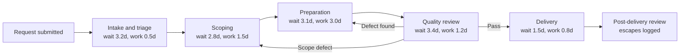
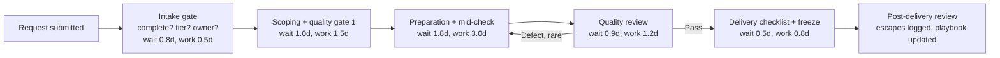

# Process maps — proper mapping, as-is and to-be

Mapping comes before fixing. A process that has not been drawn cannot be improved, because no one agrees on what the process actually is.

## How to read these maps

- Boxes are stages. Arrows are handoffs. A handoff is where waiting time lives.
- The red loop in the as-is map is rework: work returned from Quality to Preparation and Scoping.
- In the to-be map, quality gates are drawn where problems are created, not only where they are found.

## As-is flowchart

As-is totals: waiting 14 days, working 7 days, lead time 21 days, rework 22%, escapes 14%.

## To-be flowchart

To-be totals in control: waiting 5 days, working 7 days, lead time 12 days, rework 9%, escapes 5%.

## Swimlane view — who does what

| Stage | Requester | Pipeline lead | Stage owner | Quality reviewer |
|---|---|---|---|---|
| Intake | Submits, answers missing items | Triages, assigns tier | — | — |
| Scoping | Approves scope | — | Owns scope and definition of done | Gate 1 check |
| Preparation | — | Daily review | Owns the work | Mid-check |
| Quality | — | — | Fixes defects | Owns the gate, logs escapes |
| Delivery | Receives delivery note | — | Owns delivery checklist | Logs escapes same day |

## Diagnostic map — figuring it out

The diagnostic order in this project was:

1. **Measure:** weekly demand, completed, backlog, lead time, rework, escapes.
2. **Split:** lead time into waiting and working time, by stage.
3. **Rank:** Pareto of causes — incomplete intake 32%, unclear ownership 24%, late quality 21%, excess WIP 13%, last-minute changes 10%.
4. **Map:** as-is flowchart, with the rework loop drawn, not hidden.
5. **Plan:** roadmap, schedule, and risk mitigations, before any fix starts.
6. **Fix:** one change per cause, in Pareto order.
7. **Control:** same definitions, same reviews, triggers for drift.

That order is the project. A fix without a map is a guess. A map without a fix is a poster.
